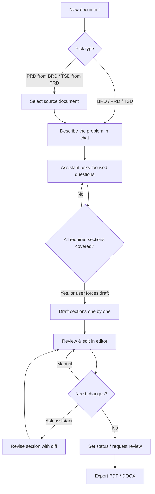

# Jangka — Product Requirements Document

|         |                                                                                                    |
| ------- | -------------------------------------------------------------------------------------------------- |
| Product | Jangka                                                                                             |
| Tagline | Precise specs for product & engineering teams                                                      |
| Owner   | Iqbal (iqbalr3000)                                                                                 |
| Status  | Draft v0.1                                                                                         |
| Related | `docs/DESIGN.md` (UX/UI), `docs/SPEC.md` (technical spec), `docs/plans/` (feature specs & roadmap) |

> This PRD follows the same section structure as Jangka's built-in PRD template (SPEC §7).
> The product's first document is about itself.

---

## 1. Overview

Jangka is a self-hosted workspace where product and engineering teams create **BRD, PRD, and TSD**
documents with LLM assistance. Instead of generating a document from one prompt, the LLM **interviews**
the user, flags what is missing, and drafts each section into a **standardized template**, including
Mermaid diagrams. Documents are organized in collections with group-based permissions, linked to each
other for traceability (BRD → PRD → TSD), and exported to DOCX or PDF.

It installs like Metabase: one Docker image plus Postgres. The organization brings its own LLM key
(Anthropic, OpenAI, Gemini, or OpenRouter), so requirements never pass through a third-party SaaS.

## 2. Problem Statement

1. **Writing specs is slow and inconsistent.** Each PM/engineer uses a different structure; reviewers
   spend time hunting for missing sections instead of evaluating decisions.
2. **Generic AI chat produces fluffy documents.** One-shot generation yields long, polished text with
   invented assumptions and no real decisions. Nobody reads it, and gaps stay hidden.
3. **Specs drift apart.** A business requirement changes in the BRD, but the PRD and TSD built on it
   are never updated, and nobody knows which downstream items are affected.
4. **Confidential requirements can't go to public AI tools.** Many companies forbid pasting internal
   plans into ChatGPT or similar services, so teams lose AI assistance entirely.
5. **Docs live everywhere.** Specs scatter across Google Drive, Notion, Confluence, and chat threads,
   with ad hoc sharing and no consistent access control.

## 3. Goals & Success Metrics

| Goal                                | Metric                                                                                              | Target                 |
| ----------------------------------- | --------------------------------------------------------------------------------------------------- | ---------------------- |
| Fast to adopt                       | Time from `docker compose up` to first login                                                        | < 5 minutes            |
| Faster specs without losing quality | Time to a complete first-draft PRD (all required sections ≥ partial)                                | < 30 minutes           |
| No invented content                 | Sections drafted without interview coverage are marked `empty`, never filled with fabricated detail | 100%                   |
| Consistent output                   | Documents that pass template completeness check before export                                       | Tracked per document   |
| Export you can send                 | PRD with 3 diagrams + 30-row table exports cleanly to PDF & DOCX                                    | No manual fixes needed |
| Traceability                        | Functional requirements in a PRD linked to at least one BR (when generated from a BRD)              | ≥ 90%                  |
| Portfolio                           | Public repo with one-command install, demo video, and LinkedIn launch post                          | At v1.0                |

## 4. Target Users & Personas

**Product Manager (primary).** Writes BRDs and PRDs weekly. Knows the problem well but loses time on
structure and formatting. Wants a tool that asks the right questions and produces something reviewers accept.

**Tech Lead / Engineer (primary).** Writes TSDs and reviews PRDs. Wants requirements with IDs, clear
non-functional requirements, and diagrams they can edit as code (Mermaid), not screenshots.

**Workspace Admin (secondary).** Usually an engineering manager or DevOps. Installs the app, configures
LLM providers and SSO, manages groups and collection permissions. Wants zero surprise: secrets stay
encrypted, access rules are predictable.

**Reviewer / Stakeholder (secondary).** Reads documents, leaves comments, approves. Mostly view-only.

## 5. User Stories

Setup & admin
- As an admin, I can install Jangka with one command and finish setup in the browser using a setup token from the logs.
- As an admin, I can add an LLM provider by pasting an API key, testing the connection, and picking a model from a list.
- As an admin, I can create groups and set each group's access (No access / View / Edit) per collection.
- As an admin, I can enable Google or generic OIDC login, restrict it to my company domain, and auto-place new users into a default group.

Writing
- As a PM, I can start a new PRD by describing the problem in chat, and the assistant asks me focused follow-up questions.
- As a PM, I can see which template sections are still missing information before drafting.
- As a PM, I can draft the whole document section by section and watch each section fill in live.
- As a PM, I can rewrite one section with an instruction ("make NFRs measurable") and review a diff before accepting.
- As a PM, I can edit any section directly in a rich-text editor without going through the assistant.
- As an engineer, I can edit diagrams as Mermaid source and see the rendered result immediately.
- As a PM, I can generate a PRD from an existing BRD, and a TSD from a PRD, with requirements linked automatically.

Organizing & sharing
- As a user, I have a personal collection that only I (and admins) can see.
- As a user, I can move documents into team collections and they inherit that collection's permissions.
- As a user, I can export a document to PDF or DOCX with a cover page and requirements appendix.
- As a reviewer, I can comment on a section and the author can resolve it.

Traceability
- As a tech lead, when a BRD requirement changes, I can see which PRD/TSD requirements need review.

## 6. Functional Requirements

Priority: **M** = must, **S** = should, **C** = could. Feature references map to `docs/plans/spec-<feature>.md` (list in SPEC §11).

### Setup & instance

| ID     | Requirement                                                                                         | Priority | Feature |
| ------ | --------------------------------------------------------------------------------------------------- | -------- | ------- |
| FR-001 | First boot prints a one-time setup token to logs; setup UI requires it                              | M        | auth    |
| FR-002 | Setup creates the first user as admin, org name, system groups; cannot run twice (concurrency-safe) | M        | auth    |
| FR-003 | Email + password login with rate limiting; session cookie                                           | M        | auth    |
| FR-004 | Admin can create users via temporary password or single-use invite link                             | M        | auth    |

### Users, groups, permissions

| ID     | Requirement                                                                                           | Priority | Feature |
| ------ | ----------------------------------------------------------------------------------------------------- | -------- | ------- |
| FR-010 | System groups `Administrators` and `All Users`; custom groups CRUD                                    | M        | access  |
| FR-011 | Collections as a tree; each user has a personal collection                                            | M        | access  |
| FR-012 | Per-group access per collection: No access / View / Edit / Inherit                                    | M        | access  |
| FR-013 | Access inherits down the tree; nearest explicit grant wins; user gets the highest level across groups | M        | access  |
| FR-014 | Documents inherit their collection's access; no per-document ACL                                      | M        | access  |
| FR-015 | Permissions matrix UI (groups × collections) for admins                                               | M        | access  |

### LLM configuration

| ID     | Requirement                                                   | Priority | Feature       |
| ------ | ------------------------------------------------------------- | -------- | ------------- |
| FR-020 | Admin adds providers: Anthropic, OpenAI, Gemini, OpenRouter   | M        | llm-providers |
| FR-021 | API keys encrypted at rest; only last 4 characters ever shown | M        | llm-providers |
| FR-022 | Test connection and list models per provider                  | M        | llm-providers |
| FR-023 | Instance-wide default provider and model                      | M        | llm-providers |

### Documents & generation

| ID     | Requirement                                                                                                 | Priority | Feature                 |
| ------ | ----------------------------------------------------------------------------------------------------------- | -------- | ----------------------- |
| FR-030 | Create a document from a template (PRD in Phase 1; BRD/TSD in Phase 2)                                      | M        | document / traceability |
| FR-031 | Interview chat: assistant asks max 3 focused questions per turn and does not draft prematurely              | M        | assistant               |
| FR-032 | Coverage checklist per template section (missing / partial / covered)                                       | M        | assistant               |
| FR-033 | Draft all or selected sections sequentially with live streaming; user can stop at any time                  | M        | assistant               |
| FR-034 | Sections with no supporting information are marked empty with a visible placeholder, never invented         | M        | assistant               |
| FR-035 | Revise a single section with an instruction; show diff; accept or reject                                    | M        | assistant               |
| FR-036 | Rich-text editing of any section; optimistic locking on concurrent edits                                    | M        | document                |
| FR-037 | Mermaid diagram blocks: live preview, auto-fix of invalid syntax (max 2 retries), error badge if unresolved | M        | document / export       |
| FR-038 | Every section change creates an immutable version (source: LLM or human)                                    | M        | document                |

### Export

| ID     | Requirement                                                                     | Priority | Feature      |
| ------ | ------------------------------------------------------------------------------- | -------- | ------------ |
| FR-040 | Export to PDF and DOCX with cover page, headings, tables, lists, code, diagrams | M        | export       |
| FR-041 | Requirements appendix table in exports                                          | S        | traceability |
| FR-042 | Export files available for 24 hours, then removed                               | S        | export       |

### Traceability

| ID     | Requirement                                                              | Priority | Feature          |
| ------ | ------------------------------------------------------------------------ | -------- | ---------------- |
| FR-050 | Requirements get stable IDs per document (`BR-`, `FR-`, `NFR-`)          | M        | traceability     |
| FR-051 | Generate PRD from BRD and TSD from PRD with automatic requirement links  | M        | traceability     |
| FR-052 | Traceability view showing upstream/downstream links                      | S        | traceability     |
| FR-053 | Linked documents the viewer can't access appear as "Restricted document" | M        | traceability     |
| FR-054 | Changed upstream requirements flag downstream links as "needs review"    | S        | impact-retrieval |

### SSO

| ID     | Requirement                                                                                          | Priority | Feature |
| ------ | ---------------------------------------------------------------------------------------------------- | -------- | ------- |
| FR-060 | Admin configures Google or generic OIDC providers at runtime (no restart)                            | M        | sso     |
| FR-061 | Allowed email domains per provider                                                                   | M        | sso     |
| FR-062 | Link by provider subject; link by email only if the IdP reports it verified; optional auto-provision | M        | sso     |
| FR-063 | Password login can be disabled once SSO works for at least one admin                                 | S        | sso     |

### Collaboration & governance

| ID     | Requirement                                                                       | Priority | Feature          |
| ------ | --------------------------------------------------------------------------------- | -------- | ---------------- |
| FR-070 | Version history per section with diff and restore                                 | M        | history-audit    |
| FR-071 | Audit log of mutating actions, viewable by admins                                 | M        | history-audit    |
| FR-072 | Custom org templates (duplicate a built-in, edit, publish as new version)         | S        | custom-templates |
| FR-073 | Threaded comments per section with resolve                                        | S        | review           |
| FR-074 | Document status workflow: Draft → In review → Approved                            | S        | review           |
| FR-075 | Assistant may reference other documents only if the requesting user can view them | M        | impact-retrieval |

## 7. Non-Functional Requirements

| ID      | Category      | Requirement                                                                                          |
| ------- | ------------- | ---------------------------------------------------------------------------------------------------- |
| NFR-001 | Deployability | One Docker image; Postgres is the only external dependency                                           |
| NFR-002 | Security      | API keys, OIDC secrets, and tokens never appear in API responses, logs, or error messages            |
| NFR-003 | Security      | Secrets encrypted with AES-256-GCM using an env-provided master key; app refuses to start without it |
| NFR-004 | Security      | All document access goes through a single permission resolver covered by a required test matrix      |
| NFR-005 | Privacy       | No telemetry or outbound calls except to the configured LLM providers and OIDC issuers               |
| NFR-006 | Performance   | First streamed token visible < 2s after the provider responds; UI stays responsive during streaming  |
| NFR-007 | Performance   | Collection browser and document open < 500 ms p95 for up to 5,000 documents                          |
| NFR-008 | Reliability   | Export and diagram jobs retry on transient failure and never block the API                           |
| NFR-009 | Cost control  | Stopping generation cancels the provider request; token usage recorded per message                   |
| NFR-010 | Accessibility | WCAG 2.1 AA for core flows; full keyboard navigation in editor and chat                              |
| NFR-011 | Portability   | Works with any OpenAI-compatible endpoint via OpenRouter adapter; no framework lock-in               |

## 8. User Flow

## 9. Out of Scope

- Hosted multi-tenant SaaS; one instance serves one organization.
- Real-time co-editing (CRDT/multiplayer cursors). Concurrent edits use per-section optimistic locking.
- Integrations with Jira, Linear, Confluence, Notion, Google Docs (candidate for after v1.0).
- Fine-tuning or hosting models; only API-based providers.
- Native mobile apps. The web UI is responsive for reading and commenting only.
- Billing, plans, or usage quotas per user.

## 10. Assumptions & Dependencies

- The organization has at least one LLM API key and accepts that document content is sent to that provider.
- Users write in English or Indonesian; the assistant replies in the language the user writes in.
- Mermaid covers the needed diagram types (flowchart, sequence, ERD, state).
- Playwright Chromium runs inside the Docker image (adds ~300 MB to image size; accepted).
- Built with Claude Code as primary implementation assistant; human review required for auth, permissions, crypto.

## 11. Risks & Mitigations

| Risk                                      | Impact                   | Mitigation                                                                                                  |
| ----------------------------------------- | ------------------------ | ----------------------------------------------------------------------------------------------------------- |
| LLM fabricates details to fill sections   | Untrustworthy docs       | Interview gating, `empty` placeholders, completeness check before export                                    |
| Provider differences in structured output | Broken parsing, flaky UX | Zod validation on every response, retry with error, per-provider schema transforms, fake provider for tests |
| Permission bugs leak documents            | Critical trust failure   | Pure resolver, required test matrix, e2e isolation tests, permission-aware retrieval                        |
| Export fidelity (tables, diagrams, fonts) | Users fix docs by hand   | Single source document model, dedicated export feature with visual checks                                   |
| Scope too large for a side project        | Never ships              | Features shippable on their own; Phase 1 = usable product                                                   |
| Mermaid syntax errors from LLM            | Broken diagrams          | Authoritative render in worker, auto-fix loop, keep source with error badge                                 |

## 12. Open Questions

1. Should approved documents be locked from editing, or allow edits that revert status to Draft?
2. Per-collection default LLM provider/model, or instance-wide only?
3. Should exports include version number and change log, or only the current state?
4. Language of built-in templates: English only, or English + Indonesian variants?
5. License for the public repo (MIT vs AGPL to discourage closed SaaS forks)?
